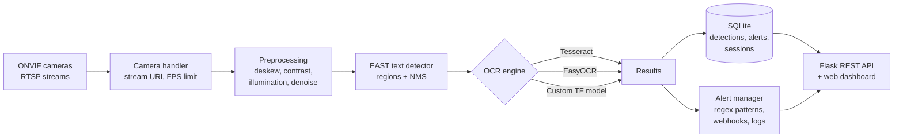

# Trakt

**Real-time text recognition from IP camera streams.** Trakt connects to ONVIF-compliant cameras, finds text in each frame, reads it with a pluggable OCR engine, stores every detection in SQLite, and raises alerts when text matches a pattern you care about (a licence plate, a container number, a serial code).

It also ships a TensorFlow training pipeline (CNN and CRNN with CTC loss) so you can train a recogniser on your own text domain instead of relying only on general-purpose OCR.

[](https://github.com/albertmwangwa/Trakt/actions/workflows/ci.yml)


---

## Why it exists

Most CCTV systems record text they never read. Gate cameras see plates, warehouse cameras see container and pallet codes, and production lines see printed batch numbers, but someone still has to watch the footage. Trakt turns those existing cameras into a searchable text log with alerts, without replacing any hardware.

## How it works



| Stage | Module | What it does |
| --- | --- | --- |
| Capture | `src/camera_handler.py`, `src/multi_camera.py` | Fetches the RTSP stream URI over ONVIF, captures frames with one thread per camera, limits frame rate |
| Detect | `src/text_detector.py` | EAST text detection with non-max suppression; perspective correction and deskewing per region |
| Read | `src/ocr_engine.py` | Tesseract, EasyOCR or a custom TensorFlow model behind one interface; confidence and length filtering |
| Store | `src/database.py` | SQLite tables for detections, alerts and camera sessions, with query and statistics helpers |
| Alert | `src/alerts.py` | Pattern rules (regex) that fire webhooks or log entries, each with a status you can acknowledge |
| Serve | `src/web_api.py`, `web/` | REST API and a lightweight browser dashboard |
| Train | `src/training/` | Dataset loading, augmentation, CNN/CRNN models, CTC loss, OCR metrics, export |

## Quick start

```bash
git clone https://github.com/albertmwangwa/Trakt.git
cd Trakt
python -m venv .venv && source .venv/bin/activate
pip install -r requirements.txt

# Tesseract is only needed if you choose the Tesseract engine
sudo apt-get install -y tesseract-ocr tesseract-ocr-eng   # macOS: brew install tesseract
```

Point `config.yaml` at your camera, then run:

```yaml
camera:
  host: "192.168.1.100"
  port: 80
  username: "admin"
  password: "change-me"     # better: set via .env, see .env.example
  fps_limit: 5

ocr:
  engine: "easyocr"         # or "tesseract"
  confidence_threshold: 0.5
```

```bash
python main.py --config config.yaml
```

No camera to hand? Run OCR on a still image instead:

```bash
python examples/basic_ocr.py --help
python examples/text_detection_pipeline.py --help
python examples/license_plate_detection.py
```

### Docker

```bash
cp .env.example .env    # add camera credentials
docker compose up -d
```

## Multiple cameras

List cameras under `cameras:` in `config.yaml`. Each one gets its own capture thread and session record, and every detection is tagged with the camera it came from.

## Alerts

Define patterns under `alerts:` in `config.yaml`. A pattern is a name, a regular expression and the actions to take (log, webhook). Alerts are stored with a status, so the dashboard or an external system can mark them acknowledged or resolved through the API.

## REST API

Start the API on its own with `python -m src.web_api` (defaults to `127.0.0.1:5000`; set `FLASK_HOST`, `FLASK_PORT` and `FLASK_DEBUG` to change it).

| Method | Endpoint | Returns |
| --- | --- | --- |
| GET | `/api/health` | Liveness check |
| GET | `/api/status` | Running state, frame and detection counters |
| GET | `/api/detections` | Latest in-memory detections |
| GET | `/api/results` | Saved result files |
| GET | `/api/cameras`, `/api/cameras/<id>` | Configured cameras and their state |
| GET | `/api/camera/info` | Primary camera details |
| GET | `/api/database/detections` | Stored detections; filter by `camera_id`, `start_time`, `end_time`, `limit`, `offset` |
| GET | `/api/database/statistics` | Totals and per-camera counts |
| GET | `/api/alerts` | Alert history |
| POST | `/api/alerts/<id>/status` | Update an alert's status |
| GET | `/api/alerts/patterns` | Configured patterns |
| POST | `/api/alerts/patterns/<name>/enabled` | Enable or disable a pattern |

The server binds to localhost by default. Put it behind a reverse proxy with authentication before exposing it on a network.

## Training a custom recogniser

General OCR struggles with stylised fonts, plates and low-resolution crops. The training module lets you fit a model to your own text domain.

```bash
# Generate a small synthetic dataset and train a CRNN on it
python examples/train_ocr_model.py --create-sample --architecture crnn --epochs 20 --augment

# Train on your own labelled crops
python examples/train_ocr_model.py --data-dir path/to/dataset --architecture crnn \
    --epochs 50 --batch-size 32 --learning-rate 0.001 --output-dir models/
```

- **Architectures:** a CNN classifier for fixed-length text, and a CRNN (convolutional feature extractor + bidirectional recurrent layers) trained with **CTC loss** for variable-length sequences.
- **Augmentation:** rotation, shift, shear, zoom, brightness, noise, blur and erode/dilate, to mimic real camera conditions.
- **Metrics:** character and word accuracy, character and word error rate (CER, WER), normalised edit distance, sequence accuracy, precision, recall and F1.
- **Export:** trained models plug straight back into the OCR engine through the `tensorflow:` section of `config.yaml`.

## Testing and quality

```bash
pip install pytest pytest-cov flake8
python -m pytest tests/ -v --cov=src
```

The suite covers camera handling, OCR, text detection, multi-camera management, the database, alerts, the web API and training: **118 tests, 63% line coverage** at the last recorded run (see [`DEPLOYMENT_TEST_RESULTS.md`](DEPLOYMENT_TEST_RESULTS.md)). GitHub Actions runs linting and the tests on Python 3.9, 3.10 and 3.11 for every push and pull request.

## Project layout

```
Trakt/
├── main.py                 # Application entry point
├── config.yaml             # Cameras, OCR, alerts, database, training
├── src/
│   ├── camera_handler.py   # ONVIF + RTSP capture
│   ├── multi_camera.py     # Concurrent streams
│   ├── text_detector.py    # EAST detection + region preprocessing
│   ├── ocr_engine.py       # Tesseract / EasyOCR / TensorFlow engines
│   ├── database.py         # SQLite persistence
│   ├── alerts.py           # Pattern alerts + webhooks
│   ├── web_api.py          # Flask REST API
│   └── training/           # Dataset, augmentation, models, metrics
├── web/                    # Dashboard (HTML, CSS, JS)
├── examples/               # Runnable scripts
├── tests/                  # pytest suite
└── models/, output/        # Model weights and run outputs (git-ignored contents)
```

## Status and roadmap

Trakt runs end to end on a single machine. The last recorded test run passed all unit tests; the Docker build hit an SSL certificate issue in that test environment, so treat the container setup as needing verification on your network.

Next steps:

- [ ] Automatic stream reconnection and ONVIF camera discovery (settings exist in `config.yaml`; logic still to wire up)
- [ ] Authentication on the REST API and dashboard
- [ ] PostgreSQL backend option for multi-site deployments
- [ ] Benchmark table: CER/WER for each engine on a public plate dataset
- [ ] Segmentation-first pipeline (promptable segmentation models) for small or curved text

## Related docs

- [`QUICKSTART.md`](QUICKSTART.md): a five-minute walk-through
- [`IMPLEMENTATION_SUMMARY.md`](IMPLEMENTATION_SUMMARY.md): design notes per module
- [`CONTRIBUTING.md`](CONTRIBUTING.md): how to contribute

## Responsible use

Reading text from cameras can capture personal data such as licence plates. Deploy Trakt only where you have a lawful basis to process that data, tell people the cameras are there, keep retention short, and restrict who can query the database.

## Author

**Albert William Mwangwa** · AI governance and data science, Dar es Salaam
[GitHub](https://github.com/albertmwangwa)

## License

[MIT](LICENSE)
